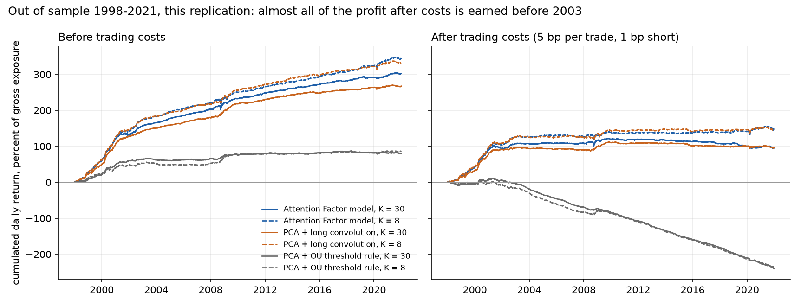

# Results of the replication

> **These are the results of round 1, the numbers on the slides.** Later rounds changed the
> training loss, three inputs, the construction of the PCA benchmark and the universe. With the objective as
> the paper prints it, the Attention Factor model with 30 factors has a Sharpe ratio of about
> 2.1 before costs and 0.1 after, not 3.00 and 0.99; and the ranking against the benchmark
> depends on how the benchmark is built. The first headline of this file, "the level
> reproduces, the ranking does not", was the reading of round 1 alone; the headline below now
> says that the ranking depends on how the benchmark is built. Read
> [README_ISSUES.md](README_ISSUES.md) and [DIFFERENCES.md](DIFFERENCES.md) first.

All numbers are out of sample, January 1998 to December 2021 (6,040 trading days), annualized,
at unit gross exposure. "After costs" subtracts the paper's cost: 5 basis points per unit traded
and 1 basis point per unit held short. Every number here comes from `runs/<name>/metrics.json`
or `runs/<name>/daily.csv` through `scripts/report.py` (tables in `results/`; the comparison of
the two trained models is `results/comparison.md`); the paper's numbers are from its Table 2.

## In one paragraph

We rebuilt the model from the paper's text and ran it on the paper's sample. **The level
reproduces; the ranking depends on how the benchmark is built.** The Attention Factor model reaches a Sharpe ratio of 3.0
before costs with a market beta of 0.05, about three quarters of the paper's 3.97; after costs
it reaches 0.99, 43 percent of the paper's 2.28. The learned trading policy beats the
Ornstein-Uhlenbeck threshold rule by a wide margin, as in the paper. But the two-step benchmark, PCA with the long convolution model, has the **higher Sharpe
ratio** here (3.47 against 3.00 before costs, 1.26 against 0.99 after), where the paper reports
a clear lead of the Attention Factor model (3.97 against 2.79, 2.28 against 1.57). With this
benchmark that lead does not appear. The Attention Factor model earns more before costs and the same after costs;
the benchmark has the lower volatility. The lead does appear when the benchmark is built from
the correlation matrix, as in Avellaneda and Lee (2010): the benchmark then earns 2.62 and 0.38,
and the Attention Factor model leads by 0.34 before costs and 0.56 after (one seed; see "Open
choices tested"). And after costs, almost all of the profit of
the two trained models is earned before 2003 (all of it with 30 factors, about 85 percent with
8): from 2003 to 2021 the models with 30 factors earn nothing and those with 8 factors about one
percent a year.

## Table 2 of the paper, beside ours

| Model | K | Sharpe ratio | (paper) | Mean % | (paper) | Vol. % | (paper) | Sharpe ratio after costs | (paper) | Mean after costs % | (paper) | Beta | (paper) | Seeds |
|---|---|---|---|---|---|---|---|---|---|---|---|---|---|---|
| Attention Factor model | 8 | 2.66 | 3.35 | 14.38 | 15.70 | 5.41 | 4.68 | 1.15 | 1.94 | 6.21 | 9.05 | 0.08 | 0.07 | 1 |
| Attention Factor model | 30 | 3.00 | 3.97 | 12.81 | 16.66 | 4.26 | 4.20 | 0.99 | 2.28 | 4.20 | 9.52 | 0.05 | 0.05 | 2 |
| Attention Factor model | 100 | 3.04 | 4.52 | 10.21 | 16.45 | 3.35 | 3.64 | 0.33 | 2.19 | 1.11 | 7.93 | 0.02 | 0.05 | 1 |
| PCA with the long convolution model | 8 | 3.07 | 2.64 | 13.87 | 14.88 | 4.52 | 5.63 | 1.35 | 1.50 | 6.10 | 8.42 | 0.06 | 0.09 | 1 |
| PCA with the long convolution model | 30 | 3.47 | 2.79 | 11.12 | 15.15 | 3.21 | 5.42 | 1.26 | 1.57 | 4.02 | 8.47 | 0.04 | 0.09 | 2 |
| PCA with an OU threshold rule | 1 | 0.22 | 0.40 | 1.14 | 1.85 | 5.17 | 4.57 | -2.42 | -2.54 | -12.48 | -11.62 | 0.02 | 0.02 | - |
| PCA with an OU threshold rule | 3 | 1.04 | 1.26 | 4.05 | 4.18 | 3.90 | 3.33 | -2.43 | -2.72 | -9.48 | -9.04 | 0.02 | 0.01 | - |
| PCA with an OU threshold rule | 5 | 1.17 | 0.99 | 4.08 | 2.91 | 3.49 | 2.93 | -2.69 | -3.44 | -9.38 | -10.11 | 0.01 | 0.00 | - |
| PCA with an OU threshold rule | 8 | 1.16 | 0.78 | 3.61 | 2.04 | 3.11 | 2.61 | -3.16 | -4.15 | -9.83 | -10.83 | 0.01 | 0.00 | - |
| PCA with an OU threshold rule | 10 | 1.02 | 0.80 | 3.04 | 1.99 | 2.98 | 2.50 | -3.49 | -4.32 | -10.38 | -10.80 | 0.01 | 0.00 | - |
| PCA with an OU threshold rule | 15 | 1.33 | 0.51 | 3.75 | 1.12 | 2.82 | 2.20 | -3.41 | -5.24 | -9.63 | -11.53 | 0.01 | 0.00 | - |
| PCA with an OU threshold rule | 30 | 1.31 | 0.18 | 3.33 | 0.40 | 2.53 | 2.24 | -3.95 | -6.45 | -10.01 | -14.74 | 0.01 | -0.00 | - |
| PCA with an OU threshold rule | 100 | 0.65 | -0.35 | 1.19 | -0.66 | 1.84 | 1.87 | -6.60 | -7.05 | -12.17 | -13.23 | 0.00 | -0.00 | - |
| Equally weighted universe | | 0.57 | 0.42 | 11.76 | 8.61 | 20.55 | 20.37 | | | | | 1.00 | 1.00 | |

Rows with two seeds show the average. The two seeds differ little: the Attention Factor model
with 30 factors gives 2.97 and 3.04 before costs (0.94 and 1.03 after); the PCA benchmark gives
3.47 and 3.46 (1.26 and 1.27). The paper reports a standard deviation of 0.13 across its seeds.

Further numbers of the runs: daily turnover (L1 change of the weights) 0.59 for the Attention
Factor model with 30 factors, 0.47 for the PCA benchmark, 0.96 for the OU rule; the cost takes
8.6, 7.1 and 13.3 percentage points of return a year (the paper's Table 2 implies 7.1 and 6.7
for the first two). Correlation of the daily return with the equally weighted universe: 0.21 to
0.30. With a ridge penalty of 1e-5 the 30 attention factors act as 26.9 effective factors; the
ten largest weights of a factor hold 7 percent of it on average; the factors explain 43 percent
of the variance of the returns out of sample (37 percent with 8 factors).

## What reproduces

1. **The level of the result.** A Sharpe ratio of 2.7 to 3.5 before costs, a mean return of 11 to
   14 percent a year at unit gross exposure, a market beta of 0.04 to 0.08. Our mean returns are
   73 to 93 percent of the paper's: 77 and 73 percent for the two model classes with 30 factors,
   92 and 93 percent with 8 factors.
2. **The learned policy against the parametric rule.** The OU threshold rule earns a Sharpe ratio
   of 1.0 to 1.3 before costs for 3 to 30 factors (0.22 with one factor, 0.65 with 100) and
   loses 9 to 12 percent a year after costs, for every number of factors. Our rows for 1, 3, 5, 8 and 10 factors are close to the paper's; for 15 to 100
   factors ours are better than the paper's before costs.
3. **More factors help before costs, up to 30.** 3.00 with 30 factors against 2.66 with 8
   (paper: 3.97 against 3.35). 100 factors add nothing (3.04; paper: 4.52); see "Open choices
   tested".
4. **The volatility of the Attention Factor model with 30 factors.** 4.26 percent (paper: 4.20).
   With 8 factors it does not match: 5.41 against 4.68 percent.

## What does not reproduce

1. **One step beats two steps.** The benchmark has the higher Sharpe ratio at 8 and at 30
   factors, before and after costs. With two seeds each at 30 factors, the paired difference of
   the daily returns (Attention Factor model minus benchmark) is +1.70 percentage points a year
   before costs (t-statistic 2.3) and +0.18 after costs (t-statistic 0.25): the Attention
   Factor model earns more before costs, trades more, and ends with the same return after
   costs. The benchmark's higher Sharpe ratio comes from its lower volatility (3.21 against 4.26
   percent). The Attention Factor model has the higher Sharpe ratio after costs in 13 of the 24
   years.

   The benchmark's lead in Sharpe ratio is not statistically clear. `results/comparison.md`
   tests it with a block bootstrap of the daily returns (blocks of 1, 21 and 63 days). With 30
   factors and the daily returns averaged over the two seeds, the Sharpe ratios are 3.11 and
   3.49 before costs and 1.02 and 1.27 after: a difference (Attention Factor model minus
   benchmark) of -0.38 and -0.25, which is 1.2 to 1.8 and 1.0 to 1.3 of its standard errors
   (0.22 to 0.31 and 0.20 to 0.25). These differences are smaller than those of Table 2 (-0.47
   and -0.27), which averages the Sharpe ratios of the seeds: averaging the returns first
   raises the Sharpe ratio of the Attention Factor model more, because its two seeds are less
   alike. Seed against seed the difference is -0.51 and -0.42 before costs (1.5 to 2.2 standard
   errors) and -0.32 and -0.23 after (0.9 to 1.5). With 8 factors and one seed each it is -0.41
   before costs (1.8 to 2.1) and -0.20 after (1.0 to 1.1). So before costs the benchmark's lead
   is at the edge of significance, and after costs it is not significant. The finding is not
   "the benchmark wins". It is that the paper's lead of 1.18 before costs and 0.71 after is
   absent: the seed-averaged difference lies 5 to 7 and 4 to 5 of its standard errors below
   it.
2. **The benchmark's volatility.** The paper reports 5.42 percent for PCA with 30 factors and the
   long convolution model; a plain PCA projection gives 3.21 percent here. For 30 factors our
   Attention Factor volatility matches the paper's and our benchmark volatility does not; for 8
   factors neither matches (5.41 against 4.68; 4.52 against 5.63). The paper's ranking of the
   two rests on this number. The paper's benchmark section says only "PCA using the past 252
   trading days"; its Section 3.1 describes PCA factors as eigenvectors of the return
   covariance matrix, the construction used here. See "Choices the paper leaves open" in the
   README, and "Open choices tested", item 1.
3. **The result after costs.** Sharpe ratios of 0.99 (30 factors) and 1.15 (8 factors) against
   the paper's 2.28 and 1.94. In the paper 30 factors beat 8 after costs; here they do not.
4. **The market row.** The equally weighted universe has the paper's volatility (20.55 against
   20.37 percent) but a mean of 11.76 percent against the paper's 8.61. In excess of the
   risk-free rate ours is about 10 percent. We cannot reconcile this number.

## Open choices tested

Six more runs, one seed each, test two choices the paper leaves open and two of its claims
(items 1 to 4). Item 5 adds two refits of the three Attention Factor runs on the test years.
Tables: `results/variants.md`, `results/table2.md` and `results/table3.md`. Each difference
below is between two runs on the same days. Its standard error comes from the block bootstrap of
`results/comparison.md` (blocks of 1, 21 and 63 days). That error measures the noise of the days,
not of the training: the two seeds of the 30-factor Attention Factor model differ by 0.08 before
costs and 0.09 after. The Attention Factor runs are compared with seed 0 of the 30-factor model
(2.97 before costs, 0.94 after).

1. **The benchmark's construction decides the ranking.** We rebuilt the benchmark like Avellaneda
   and Lee's (2010) eigenportfolios (`--pca corr`). It uses the eigenvectors V of the correlation
   matrix, factor weights V/σ, and the in-window regression loadings σV. With 30 factors it
   earns 2.62 before costs and 0.38 after (paper: 2.79 and 1.57). The Attention Factor model is
   then ahead, as in the paper: by 0.34 before costs (1.6 to 1.7 standard errors) and 0.56 after
   (3.0 to 3.3). The benchmark's volatility rises only to 3.50 percent (paper: 5.42), and its
   turnover from 0.47 to 0.52. So the correlation PCA explains the ranking, but not the
   benchmark's volatility.
2. **How the residual history is built matters little.** By default, the residual of each of
   the 30 past days comes from that day's factor model. The variant applies the decision date's
   factor model to all 30 days (`--lookback current`). This changes the PCA benchmark by less
   than 0.1 (3.52 and 1.33 with the covariance PCA, 2.63 and 0.43 with the correlation PCA). It
   costs the Attention Factor model 0.15 before costs and 0.20 after (2.81 and 0.75; 1.4 to 2.2
   standard errors).
3. **100 factors do not help.** With 100 factors the Attention Factor model earns 3.04 before
   costs, 0.08 above 30 factors (0.5 standard errors), and 0.33 after costs, 0.61 below (3.5 to
   4.6). The paper reports 4.52 and 2.19. The extra factors are used: they explain 51 percent of
   the variance against 43, and act as 90.9 effective factors. They lower the volatility to
   3.35 percent and raise the turnover to 0.62. The cost then takes 9.1 of the 10.2 percent mean
   return.
4. **Past returns are not the key characteristics here.** Without the past-return group (the
   paper's Table 3), the model earns 2.59 before costs, 0.37 below the full model (2.2 to 2.7
   standard errors). After costs it earns 1.02, 0.08 above. The paper reports 1.50 and 0.59,
   the largest drop of any group. A conjecture, not tested: the sequence model reads the same
   information from the 30-day residual history.
5. **The annualized Sharpe ratio in the objective holds on the test years.** The reported runs
   annualize the Sharpe ratio in the objective, a choice made on validation data (7.50 against
   5.17 after costs). A refit of the three Attention Factor runs with the Sharpe ratio per day,
   as the paper prints it, earns 2.10 before costs and 0.09 after with 30 factors (two seeds;
   annualized: 3.00 and 0.99). With 8 factors it earns 2.10 and 0.42 (annualized: 2.66 and
   1.15). With 30 factors, the gap after costs to PCA with the long convolution model widens
   from -0.25 to -1.18 (seed-averaged returns). A second refit keeps the Sharpe ratio per day,
   takes the loss over the whole eight-year training window with one update per epoch, and
   drops the floor of -1 on each stock's explained variance. It earns 1.47 and -1.73 with 30
   factors, and 1.47 and -0.90 with 8. The tables are `results/daily_sharpe/comparison.md` and
   `results/adjusted_loss/comparison.md`.

## Over time

Sharpe ratio before costs / after costs / mean return after costs in percent a year:

| | 1998-2002 | 2003-2009 | 2010-2021 |
|---|---|---|---|
| Attention Factor model, K = 30 (seed 0) | 5.69 / 3.90 / 21.6 | 2.37 / 0.39 / 1.8 | 1.79 / -0.61 / -2.0 |
| Attention Factor model, K = 30 (seed 1) | 5.87 / 4.08 / 22.2 | 2.57 / 0.38 / 1.6 | 1.78 / -0.37 / -1.3 |
| PCA with the long convolution model, K = 30 (seed 0) | 6.17 / 4.15 / 19.2 | 3.49 / 0.68 / 2.1 | 1.76 / -0.50 / -1.2 |
| PCA with the long convolution model, K = 30 (seed 1) | 6.22 / 4.15 / 18.9 | 3.54 / 0.81 / 2.6 | 1.66 / -0.57 / -1.3 |
| Attention Factor model, K = 8 | 5.30 / 3.86 / 25.4 | 1.94 / 0.30 / 1.7 | 1.72 / 0.19 / 0.9 |
| PCA with the long convolution model, K = 8 | 5.86 / 4.24 / 25.2 | 2.42 / 0.53 / 2.5 | 1.88 / 0.06 / 0.2 |



Before costs every trained model earns in every period, at a falling rate. After costs the
picture is different: with 30 factors the Attention Factor model has cumulated 107.5 percent by
the end of 2002 and 95.9 percent by the end of 2021 (seed 0, the run in the figure; seed 1:
110.5 and 105.7), so it loses money over the last 19 years; the benchmark goes from 95.4 to
96.2 percent (seed 1: 94.2 to 96.4). With 8 factors both go from about 126 to about 147 percent
(the Attention Factor model from 126.6 to 148.7, the benchmark from 125.8 to 146.1).
Over 2003 to 2021 the Sharpe ratio after costs is between -0.16 and 0.04 for the four runs with
30 factors and 0.23 and 0.27 for the two with 8 factors. The 24-year averages of Table 2 are
averages of five very good years and nineteen flat or nearly flat ones.
The paper's Figure 2 shows returns whose scale fits returns before costs; it has no curve after
costs and no curve of this benchmark.

## Validation, 1996 to 1997

The choices that the paper leaves open were made on these two years only (training on the six
years before each). Sharpe ratio before / after costs:

| Configuration | Before | After |
|---|---|---|
| Attention Factor model, K = 30, main specification | 10.91 | 7.50 |
| the same without the explained-variance term | 10.09 | 6.88 |
| the same with the Sharpe ratio per day in the objective (the literal reading) | 8.24 | 5.17 |
| the same with ridge penalty 1e-4 / 1e-6 / 1e-7 | 10.59 / 10.65 / 10.75 | 7.45 / 7.15 / 7.21 |
| PCA with the long convolution model, K = 30 | 9.11 | 6.00 |
| Attention Factor model, K = 8 | 8.98 | 6.53 |
| PCA with the long convolution model, K = 8 | 8.70 | 6.04 |
| PCA with an OU threshold rule, K = 8 | 3.92 | -0.49 |

On these two years the Attention Factor model is ahead of the benchmark, as in the paper, and
the explained-variance term helps, as the paper says. Over the 24 test years the benchmark has
the higher Sharpe ratio. Two years on which the settings were chosen are weak evidence. The
choice of the annualized Sharpe ratio also holds on the test years ("Open choices tested",
item 5).

## Where this replication differs from the paper

- **Universe.** The 500 largest stocks by the CRSP market capitalization of the security. The
  paper's universe cannot be this: three firms it names among its 500 stocks at the start of
  2021 (Shell, Imperial Oil, Ecopetrol) rank 576, 646 and about 7,200 by that measure.
- **Characteristics.** Reconstructed from the literature the paper cites; the paper gives no
  formulas.
- **Settings the paper does not state.** The ridge penalty, the unit of the Sharpe ratio in the
  objective, the batch, the input and output of the sequence model, the construction of the
  PCA benchmark, the constants of the OU rule. See the README.
- **Scope.** The Attention Factor model is run with 8, 30 and 100 factors, and PCA with the
  long convolution model with 8 and 30 factors. No other numbers of factors were run for either
  model. Of Table 3 (groups of characteristics removed) only the past-return group was run. One
  or two seeds.
- **Data vintage.** WRDS files as of November 2026.

## What we learned from the gap

Measured:

- The paper's central comparison depends on how the benchmark is built. A PCA benchmark with an
  exact projection on the eigenvectors is a strong, low-volatility strategy. Built from the
  correlation matrix as in Avellaneda and Lee, it is weaker, and the Attention Factor model
  leads, as in the paper.
- The unit of the Sharpe ratio in the objective, which the paper does not give, decides whether
  the trading objective reaches the factors at all: 7.50 against 5.17 after costs on validation,
  and 0.99 against 0.09 on the test years (30 factors).
- The 40 "level" inputs cannot change the factor weights of the paper's equation; their
  gradient is zero up to rounding (`tests/test_model.py`), and the training loop sets it to zero.
- After the paper's own cost of 5 basis points, the strategies with 30 factors have earned
  nothing since 2003 in this replication, and those with 8 factors about one percent a year.

Conjectures, not tested here:

- The first five years carry the result because quoted prices moved in sixteenths of a dollar
  until 2001: a strategy that buys yesterday's losers at the closing price earns part of the
  bid-ask spread on paper, and that spread was larger than the assumed cost.
- The Attention Factor model's higher volatility comes from its factors explaining less variance
  than principal components do (43 percent with 30 factors), so more common risk stays in the
  residual portfolios.

## What did not work

- **The WRDS API ignored filters without an error.** The Compustat request asked for the
  standard industrial format; the server sent every format, and the first version kept the
  financial-services record for about 300 firms, which left a fifth of the universe without
  thirteen accounting characteristics. Found by the audit; all filters are now applied again
  locally (59,217 rows were sent that did not match).
- **The explained-variance term blew up.** A stock whose price hardly moves in a batch (a
  takeover target) has a variance ratio in the hundreds and took over the gradient of the
  factors. Fixed by bounding one security's term and requiring half a batch of valid days.
- **A masking bug in the PCA benchmarks**: empty slots wrote into the first security's column,
  so that security was never traded. Found by the audit.
- **The first universe was too narrow**: U.S. common stocks only, which leaves out the trusts
  and foreign firms the paper's Figure 3 shows.
- **The objective read literally trains the factors almost only to explain variance** and does
  clearly worse on validation and on the test years.
- **Compute planning.** Three trainings, two validation runs and six writing agents on four
  cores made every run look like a four-hour run. Alone on two cores a 30-factor run takes
  under an hour. The scope was cut before this was understood.
- **Numbers we cannot reconcile with the paper**: the market row, the benchmark's volatility,
  the membership of three named firms, and the result after costs.
- **The validation ranking did not hold out of sample.**

## Which code produced the numbers

Every reported run comes from the committed code. The last change to the training code during
the runs was a speed-up of the PCA path (it computes only on the securities of each batch); it
leaves the weights unchanged to 1e-8. After it, the eight OU runs were rerun and are identical to
four decimals, the two years of one PCA run that predated it were retrained, and one year of an
Attention Factor run was retrained to exactly the same weights.

## Reproduce these numbers

```bash
.venv/bin/python scripts/run.py attention --k 30            # and --seed 1
.venv/bin/python scripts/run.py attention --k 8
.venv/bin/python scripts/run.py pca --k 30                  # and --seed 1
.venv/bin/python scripts/run.py pca --k 8
for k in 1 3 5 8 10 15 30 100; do .venv/bin/python scripts/run.py ou --k $k; done
# open choices tested (the correlation PCA needs: scripts/build.py pca_corr)
.venv/bin/python scripts/run.py attention --k 100
.venv/bin/python scripts/run.py attention --k 30 --drop past_returns
.venv/bin/python scripts/run.py attention --k 30 --lookback current
.venv/bin/python scripts/run.py pca --k 30 --pca corr                  # and --lookback current
.venv/bin/python scripts/run.py pca --k 30 --lookback current
.venv/bin/python scripts/report.py
```
